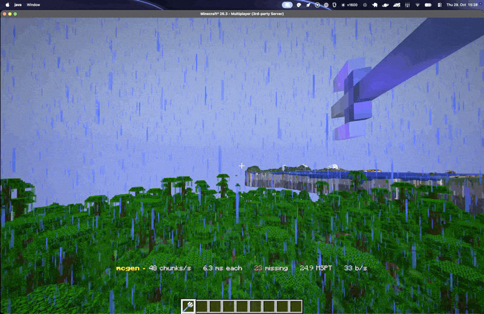

**Minecraft terrain generation, rewritten in Rust. Fly as fast as you want: the world is already there.**



Hematite is a Paper plugin that takes over terrain generation (the shape of the land, caves and surface) and produces exactly the same blocks as vanilla, only faster. It also generates chunks ahead of fast players, so elytra flights stop running into the edge of the world.

## Features

- **Same world, faster.** Terrain shape, biomes, aquifers, surface and caves match Mojang's generator block for block. Same seed, same world, so you can add it to an existing world without seams.
- **Look-ahead for elytra.** For anyone moving faster than 8 blocks per second, Hematite generates the chunks they will see in the next 5 seconds, before they come into view.
- **Safe by default.** The first chunks are generated by both vanilla and Hematite and compared. If they don't match, Hematite stays off and vanilla does everything.
- **Distant Horizons to the horizon.** Fill the DH Support plugin's database with tens of thousands of distant LODs in minutes, without the server generating a single chunk.
- **Live stats.** An action bar for admins: chunks per second, time per chunk, chunks missing around you, MSPT and your speed.

## Performance

Time until a chunk that comes into view is ready, measured with `/hematite fly` on a 15-core Mac:

| Test | Without | With |
| --- | --- | --- |
| Look-ahead, 1 player at 33 blocks/s | 100–160 ms | 5–9 ms |
| Rust terrain, 4 players at 67 blocks/s, view distance 16, 12 threads | 138 ms | 34 ms |

## Installation

Needs Paper 26.3 and Java 25. Runs on Linux (x86_64 and ARM), Windows (x86_64) and macOS (Apple Silicon and Intel), all from the same jar.

1. Put `hematite.jar` in your `plugins` folder.
2. Set Hematite as the overworld generator in `bukkit.yml`:

   ```yaml
   worlds:
     world:
       generator: Hematite
   ```

3. Let Paper keep up with fast players, in `config/paper-global.yml`:

   ```yaml
   chunk-loading-basic:
     player-max-chunk-load-rate: -1.0
     player-max-chunk-send-rate: -1.0
   chunk-system:
     worker-threads: 6
   ```

   Paper's defaults cap each player at 75 chunks per second and use few threads for chunks (3 on a 15-core Mac).

4. Restart. When the first new chunks generate, the console says `Hematite enabled: Rust now generates noise, surface and caves`.

Optional: start Java with `--enable-native-access=ALL-UNNAMED` to hide a warning about native code.

## Commands

| Command | What it does |
| --- | --- |
| `/hematite` | Turns the action bar on or off and shows totals |
| `/hematite fly <blocks/s> <seconds> [view distance] [players] [on/off]` | Simulates players flying over new terrain, with look-ahead on or off, and reports how fast chunks were ready |

Both need `hematite.admin`, which ops have by default.

## Good to know

- Hematite generates terrain shape, surface and caves. Structures, ores, trees, plants, mobs and light are still vanilla, and chunks next to structures are generated fully by vanilla.
- Paper rounds a few noise values differently from Mojang's code, so some chunks differ from a Paper server without Hematite by a handful of blocks.
- Start the server with `-Dhematite.verify=true` to compare every chunk with vanilla. It's slow and meant for testing.

## Distant Horizons

[DH Support](https://gitlab.com/distant-horizons-team/distant-horizons-server-plugin) sends distant terrain to players running Distant Horizons. Normally it loads or generates the 16 real chunks behind each distant section, which is heavy. With Hematite's command-line tool and `tools/dhs_config.py` from this repository (see Building), you can fill its database up front and switch that off:

```sh
# in the server folder; once: put the DH Support jar in plugins, start the server, stop it
python3 tools/dhs_config.py plugins/DHSupport/config.yml   # serve stored LODs only
HEMATITE_JAR=versions/26.3/paper-26.3.jar hematite export-dhs <seed> world plugins/DHSupport/data.sqlite 512
```

Run it with the server stopped. `HEMATITE_JAR` points the tool at the game data, and Paper's own server jar works. The seed is shown by `/seed`, and the radius is in chunks around 0,0. 512 chunks (8,192 blocks in every direction) takes about 5 minutes and 530 MB. Distant terrain has trees but no structures. Block changes don't update other players' distant terrain.

## Command-line tool

Hematite also works on its own, for example to give a single-player world a huge Distant Horizons render distance:

```sh
cargo build --release

# new world in the Shooting star Modrinth profile, plus LODs for a radius of 1024 chunks
tools/make_world.sh "My World" 8675309 1024

# or step by step
python3 tools/new_world.py "<saves>/ende" "<saves>/horizon" "Horizon" <seed> $(./target/release/hematite spawn <seed>)
./target/release/hematite export <seed> "<saves>/horizon/dimensions/minecraft/overworld/data/DistantHorizons.sqlite" 1024

# top-down map of 12x12 sections from section -6,-6, and a map decoded from an existing DH database
./target/release/hematite render <seed> map.ppm -6 -6 12
./target/release/hematite preview DistantHorizons.sqlite 3 map.ppm
```

It reads worldgen data from the game jar in `HEMATITE_JAR`, any 26.3 client or server jar, or by default the Modrinth app's 26.3 install on macOS. It exports about 5,000 chunks per second on a 15-core Mac (radius 1024 in roughly 15 minutes). Underground detail hidden below the surface is left out, which makes files about 5x smaller; set `NO_CULL=1` to keep it.

LOD trees use vanilla's tree types and shapes in different positions, snow and ice follow vanilla's rules on top of them, and light is sky light straight down. Structures, ores, lakes and small plants are left out.

## Building and verifying

```sh
cargo build --release   # command-line tool: target/release/hematite
paper/build.sh          # plugin with the engine for this machine: paper/run/plugins/hematite.jar (downloads Paper the first time)
paper/build.sh --all    # plugin with engines for every platform, for release (needs zig and cargo-zigbuild)
paper/start.sh          # test server in paper/run with Hematite
```

Worldgen data (density functions, noises, biomes, surface rules, carvers, trees) is read from the game jar at runtime, so nothing is hardcoded for a version except the algorithms.

```sh
tools/verify/check.sh <seed> 100                   # 100 random chunks, block by block against Mojang's generator
tools/verify/same_db.sh a.sqlite b.sqlite          # two exports are identical
tools/verify/check_dhs.sh <DHSupport/data.sqlite>  # DH Support rows decode with Distant Horizons' own code
tools/verify/platforms.sh                          # Linux and Windows builds generate byte-identical chunks (Docker, Wine)
```

These need a JDK and the 26.3 install from the Modrinth app. The other files in `tools/verify` check density values, biomes, temperatures and DH decoding the same way.
